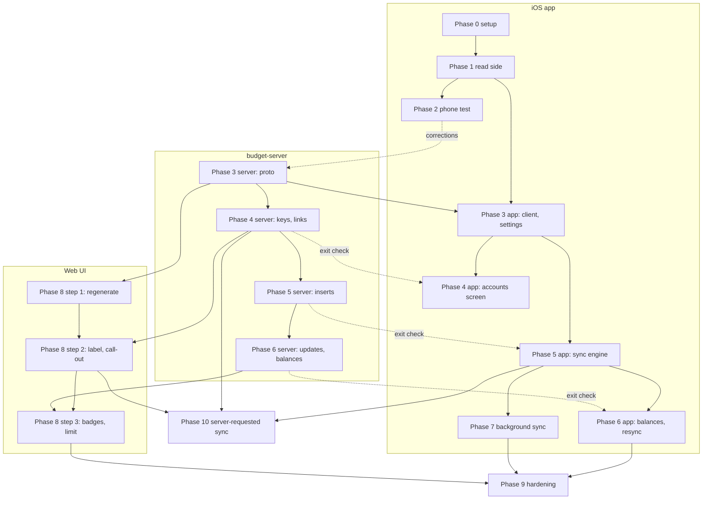

# FinanceKit sync: plan

Status: proposed · 2026-11-13

## Goal

Get Apple Card, Apple Cash and Apple Savings accounts, transactions, balances and credit limits into budget-server. FinanceKit is on-device only, so an iOS app reads Wallet data on the phone and pushes it to budget-server over ConnectRPC. The FinanceKit entitlement was approved on 2026-11-13.

This replaces `budget-stack/docs/apple-sync-plan.md` and the abandoned LunchSync bridge plan (`budget-ingest`, in that repo's git history). Decisions from both are carried forward where they still apply.

```
┌──────────────── iPhone ────────────────┐         ┌────────── home server ──────────┐
│ Wallet ─► FinanceKit                   │         │ Traefik ─► edge (Caddy) /api     │
│             │ history tokens           │  HTTPS  │              │                   │
│  OpenPersonalFinance app ──────────────┼────────►│        budget-server             │
│  OpenPersonalFinanceDelivery extension │ Connect │        FinanceKitService         │
│  (Keychain: endpoint URL + API key)    │ Bearer  │              │                   │
└────────────────────────────────────────┘         │           Postgres               │
                                                   └──────────────────────────────────┘
```

Data only flows phone → server. FinanceKit background delivery and iOS decide when a sync happens. From phase 10 the server can also ask the phone to sync with a silent push, but it never pulls.

## How it works for the user

1. On the server, create an API key for the phone: `docker exec budget-server /budget-server-key create "Carson's iPhone"`.
2. In the app, enter the **endpoint URL** (for example `https://budget.prod.carsonnetworks.net/api`) and paste the key. **Test connection** confirms both.
3. Grant FinanceKit access and pick which Wallet accounts to share.
4. For each Wallet account, tap **Add to budget**. This is the only way a FinanceKit account is created. The web UI's Add account menu only shows a call-out pointing at the app.
5. Pick a sync frequency (hourly, daily or weekly). From then on the app syncs in the background, on open, and from a **Sync now** button.

## Components

| Piece | Repo | Role |
|---|---|---|
| `OpenPersonalFinance` app, `OpenPersonalFinanceDelivery` extension, `OpenPersonalFinanceKit` package | `budget`, under `ios/` | Reads FinanceKit, pushes changes, owns history tokens and the outbox |
| `FinanceKitService` | budget-server | New ConnectRPC service, bearer-key protected. New sync type whose provider is a no-op until phase 10, then sends the silent push. Link tables, pending flag, credit limit, last-synced |
| Web UI | `budget`, under `src/` | Call-out in Add account, "Apple Wallet" label, last-synced, pending badge, credit limit, and a Sync button (phase 10) |
| Local stack, production compose | budget-stack, infra-prod | Local builds, version bumps |

## Design decisions

Numbered so tasks can refer to them.

1. **Dedicated RPCs, not the existing ones.** `FinanceKitService` has its own account and change RPCs, scoped to FinanceKit-type accounts.
2. **No-op sync provider until phase 10.** Required: `Orchestrator.Sync` errors on any account whose sync type has no registered provider, which would break Plaid sync-all too. In phase 10 the provider starts sending the silent push.
3. **Last-synced time lives in budget-server**, updated by every write RPC, so the web UI can show it.
4. **Pending is shown.** budget-server stores a `pending` flag; the UI badges it. A pending charge is updated in place when it books.
5. **Rejected and deleted charges are removed automatically.** FinanceKit reports both, so the "vanished charge" gap in the LunchSync plan is gone.
6. **Fixed shapes first, behaviour second.** The whole proto, including the phase 10 push-token RPC, is defined in phase 3 and implemented slice by slice.
7. **Bearer API key, created by a command in the budget-server image**, printed once and stored hashed. One named key per phone. Only `FinanceKitService` checks it; the web RPCs stay as they are.
8. **Accounts are created only from the app.** There is no web or generic RPC path that produces a FinanceKit-type account.
9. **Link tables on the server, as Plaid does it.** `financekit_account_links` and `financekit_transaction_links` map FinanceKit UUIDs to budget IDs. Writes are upserts keyed on the FinanceKit ID, so a replayed batch changes nothing.
10. **A history token is saved only after the server acknowledges the batch it covers.** A killed run replays from the last saved token.
11. **One syncing phone per account until the device test says otherwise.** Several phones may see the same Wallet account (Apple Card Family). Each link records which key owns it; a second phone sees the account as "synced by <key name>" and can take it over. Phase 2 tests whether FinanceKit IDs match across phones; if they do, the restriction is lifted in phase 9.
12. **Background sync is the FinanceKit background delivery extension** (iOS 26) at a user-picked `hourly` / `daily` / `weekly` frequency, with `BGAppRefreshTask` and sync-on-open as backups. No APNs until phase 10, which adds a server-requested sync on top.
13. **iOS 26 minimum, Swift 6, SwiftUI, a committed Xcode project.** The app is `OpenPersonalFinance`, bundle ID `net.carsonnetworks.OpenPersonalFinance`. It lives in `ios/` in the budget repo, with its own CI job and release tag prefix (`ios-v*`) so web releases are unaffected. No project generator: the `.xcodeproj` is committed and uses folder-synchronized groups.
14. **Credit limit only.** Due date, minimum payment and overdue amount are available from FinanceKit but left to phase 11.
15. **Local state is Codable files in the App Group container** (tokens, outbox, run log), shared by the app and the extension. No SwiftData.

## FinanceKit facts this plan relies on

Checked against Apple's documentation on 2026-11-13.

| Fact | API |
|---|---|
| Incremental reads with resumable tokens | `transactionHistory(forAccountID:since:isMonitoring:)`, `accountHistory(since:isMonitoring:)`, `accountBalanceHistory(forAccountID:since:isMonitoring:)`; `HistoryToken` is `Codable` |
| Each change set has inserted, updated and deleted items | `FinanceStore.Changes` |
| Transaction status values | `authorized`, `pending`, `booked`, `rejected`, `memo` |
| Credit data on liability accounts | `LiabilityAccount.creditInformation.creditLimit` (also `minimumNextPaymentAmount`, `nextPaymentDueDate`, `overduePaymentAmount`) |
| Balance | `AccountBalance.currentBalance` (`available`, `booked`, or both) |
| Background delivery, iOS 26+ | `enableBackgroundDelivery(for:frequency:)`, `BackgroundDataType` (`accounts`, `accountBalances`, `transactions`), `UpdateFrequency` (`hourly`, `daily`, `weekly`), `BackgroundDeliveryExtensionProviding.didReceiveData(for:)` / `willTerminate()` |
| Extension needs an App Group shared with the app | "Implementing a background delivery extension" |
| No data in the Simulator | Everything is built behind a protocol with a fake source |

Not verified, covered by phase 2: balance sign for Apple Card, whether a pending charge keeps its ID when it books, whether IDs match across two phones, and how often background delivery really fires.

## Phases

Phases are numbered in the order they are checked, not the order work must start: the app, server and web tracks run in parallel (see [Parallel work](#parallel-work)). A phase's exit check needs every earlier phase it depends on to have passed. Each phase ends with a release and deploy, which is implied and not listed as a task.

| Done | # | Phase | Outcome |
|---|---|---|---|
| [ ] | 0 | [Setup](phase-0-setup.md) | An empty app builds, tests and reaches TestFlight from CI; the stack runs local builds |
| [ ] | 1 | [FinanceKit read side](phase-1-financekit-read.md) | The app reads Wallet data behind a protocol and shows it on a diagnostics screen; nothing is sent |
| [ ] | 2 | [Phone test](phase-2-phone-test.md) | Device-only questions answered on real phones; contract corrected. Go/no-go on shared accounts |
| [ ] | 3 | [Server endpoints, wired to the app](phase-3-server-endpoints.md) | `FinanceKitService` and every new field exist, unimplemented; the app has a generated client and an endpoint setting |
| [ ] | 4 | [Accounts and auth](phase-4-accounts.md) | A key is required; a Wallet account added in the app exists in budget-server |
| [ ] | 5 | [Transactions](phase-5-transactions.md) | A sync inserts transactions correctly; a second sync adds nothing |
| [ ] | 6 | [After the first insert](phase-6-after-first-insert.md) | Pending, updates, deletes, balances, credit limit, last-synced |
| [ ] | 7 | [Background sync](phase-7-background-sync.md) | Syncs on the chosen interval with the app closed |
| [ ] | 8 | [Web UI](phase-8-web-ui.md) | Call-out, label, last-synced, pending badge, credit limit |
| [ ] | 9 | [Hardening](phase-9-hardening.md) | A week of unattended sync on every phone, with alerting |
| [ ] | 10 | [Server-requested sync](phase-10-server-requested-sync.md) | Syncing an Apple Wallet account from the web UI wakes the phone with a silent push |
| [ ] | 11 | [Follow-ups](phase-11-follow-ups.md) | Unscheduled |

Until phase 8 step 2 is deployed, FinanceKit accounts show as "Manual" in the web UI.

## Parallel work

Three tracks can run at the same time. An arrow means "needs this first".



- **Can start today:** phase 0 then phase 1 (app), server phase 3 (proto), and budget-stack's local-build mode (P0-X1).
- **Server phase 3 is the main unblocker.** Its release lets the app generate its client and the web regenerate its clients.
- **The server chain needs no app.** Phases 3 to 6 on the server can be built and tested by calling the RPCs directly.
- **App phases 4 to 6 are built against fakes.** They need the matching server phase only to pass their exit checks (dashed arrows).
- **Phase 2 only softly blocks the server.** Its results are handled on the app side; starting server phase 3 before it risks an additive proto change at most.
- **Phase 7 needs app phase 5, not phase 6.** Phase 8 needs only the server. Phases 9 and 10 do not depend on each other.
- **Within one repo area, tasks go one at a time:** the server chain shares migration numbers and the app tasks share one package. Human tasks and exit checks are the real bottleneck.

Each phase file opens with a progress table listing its tasks and a **Depends on** line; tick the phase here when its exit check has passed.

Supporting files:

- [Working rules](working-rules.md): what the implementing agent must follow in every task.
- [Sync contract](sync-contract.md): mapping rules, the proto, the tables, and the phone-test results.

## Risks

| Risk | Mitigation |
|---|---|
| Phone can't reach the server away from home | Sync is retried on every trigger and the outbox keeps unsent batches. On-demand VPN is a human setup step in phase 2. |
| Background delivery fires less often than its frequency suggests | `BGAppRefreshTask` and sync-on-open as backups; the stale warning in the web UI shows when it stops. |
| FinanceKit reads fail while the phone is locked | Treated as "retry later", not an error. |
| Shared accounts have different IDs on each phone | One owner per account (decision 11); phase 2 decides whether more is possible. |
| User revokes FinanceKit access or removes an account from sharing | The app shows the account as disconnected; the server keeps the data. |
| Version coupling between app and server | The proto is fixed in phase 3; any later change stays additive; the app pins a budget-server proto tag; deploy the server first. |
| Silent push is throttled or dropped by iOS | It is only a nudge (phase 10); the phase 7 triggers do not depend on it. |
| TestFlight builds expire after 90 days | Calendar reminder; a tag push re-releases. |
| macOS CI minutes | The iOS job only runs when `ios/**` changes. |
